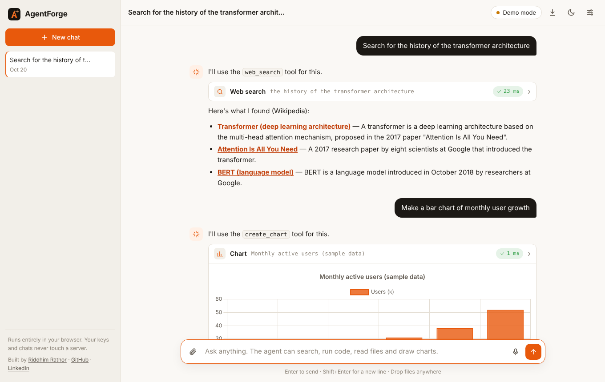
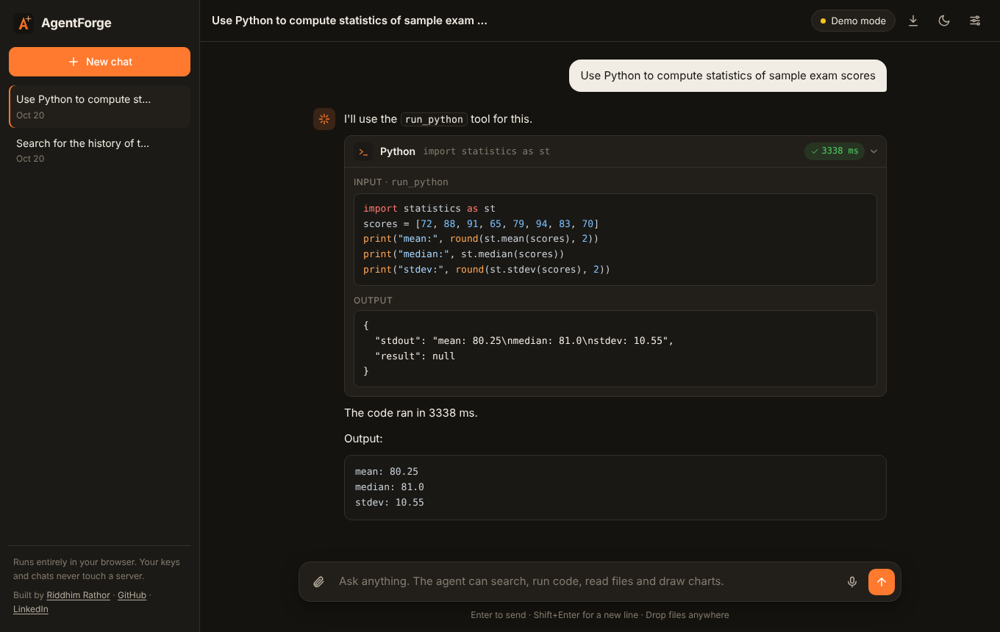
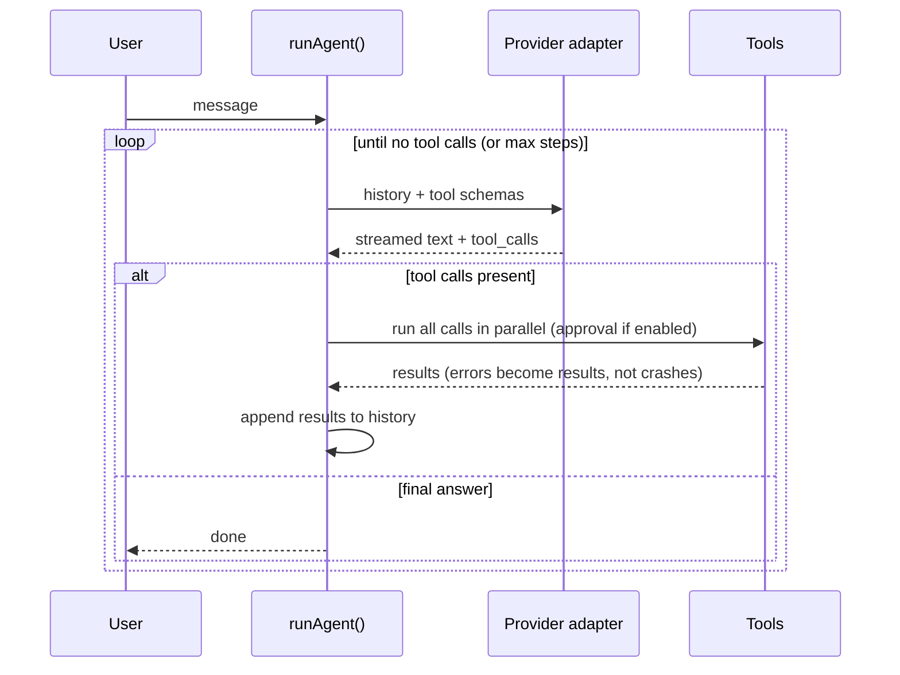
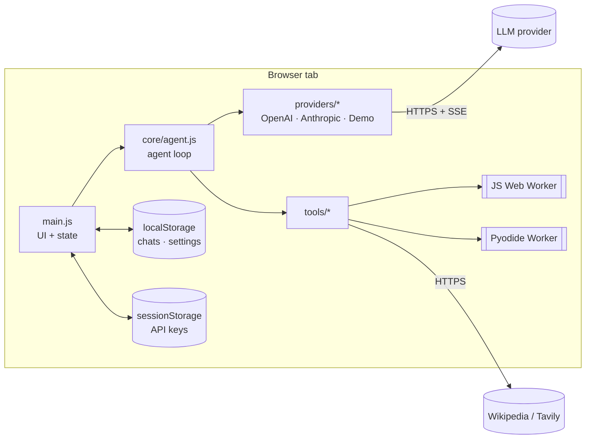

<div align="center">


# AgentForge

**A tool-using AI agent that runs entirely in your browser.**
It plans, calls real tools, reads the results and keeps going until the job is done. No backend, no build step. Bring your own model.

[**Try it live →**](https://agentforge.vercel.app) &nbsp;·&nbsp; [How it works](#how-the-agent-loop-works) &nbsp;·&nbsp; [Run locally](#run-it-locally)




</div>

---

## Why I built this

Most agent demos need a Python server, a hosted API key and a deployment. I wanted to see how much of a real agent can run **client-side only**:

- **Nothing to host** except static files, so it deploys anywhere for free.
- **No shared secret.** Each user's key goes straight from their tab to their provider.
- **Small enough to read in one sitting.** The whole agent loop is about 100 lines ([`src/core/agent.js`](src/core/agent.js)).

It also works with **no key at all**. Demo mode swaps the LLM for a small scripted planner, but every tool it calls is real. Anyone can open the link and see the agent loop working within seconds.

## What it can do

| Tool | What it does | How it runs in the browser |
| --- | --- | --- |
| `web_search` | Looks things up and cites sources | Wikipedia API (no key), or full-web search with a [Tavily](https://tavily.com) key |
| `run_javascript` | Calculations, data transforms, quick checks | Isolated **Web Worker**, terminated after 10 s, so infinite loops can't freeze the page |
| `run_python` | Real CPython: statistics, pandas, numpy | **Pyodide** (WebAssembly) in a worker. Loads on first use, state persists, attached files are mounted at `/data/` |
| `read_file` | Reads files you attach or drop in | Text, code, CSV, JSON, Markdown, and **PDF** (text extracted with pdf.js); pages through long files |
| `create_chart` | Draws charts in the conversation | Chart.js (bar, line, pie, doughnut, scatter, radar) |
| `get_datetime` | Knows "today" | `Intl` API |

**Models:** OpenRouter, OpenAI, Anthropic, Google Gemini, Groq, AI Pipe, local **Ollama**, or any OpenAI-compatible endpoint.

**Around the agent**
- **Streaming** responses, with every tool call shown as a card: arguments, output, timing and status.
- **Human-in-the-loop mode:** approve or skip each code execution before it runs.
- **Stop** a run at any point. The history is repaired so the next request stays valid.
- Parallel tool calls, a configurable step limit, an editable system prompt, and per-conversation token usage.
- Conversations saved locally, Markdown export, voice input, light/dark themes, mobile layout, installable as a PWA.



## How the agent loop works



The core is provider-agnostic. Messages use one neutral shape, and each provider adapter converts it to its own API format:

```js
{ role: 'user', content }
{ role: 'assistant', content, toolCalls: [{ id, name, arguments }] }
{ role: 'tool', toolCallId, name, content, isError, ms }
```

| Adapter | Covers | Notes |
| --- | --- | --- |
| [`openai.js`](src/providers/openai.js) | OpenAI, OpenRouter, Gemini, Groq, AI Pipe, Ollama, custom | Re-assembles tool calls whose JSON arguments arrive in fragments across SSE chunks |
| [`anthropic.js`](src/providers/anthropic.js) | Claude models | `tool_use` / `tool_result` content blocks, `input_json_delta` streaming, merges consecutive results into one user turn |
| [`demo.js`](src/providers/demo.js) | No key | Keyword planner that drives the real tools |

## Architecture



```
agentforge/
├── index.html              # markup only
├── styles.css              # design tokens, light/dark themes, responsive layout
├── src/
│   ├── main.js             # UI controller: conversations, streaming render, settings, files
│   ├── render.js           # Markdown (sanitised), tool cards, charts
│   ├── storage.js          # localStorage/sessionStorage persistence
│   ├── core/
│   │   ├── agent.js        # runAgent, executeToolCall, repairHistory
│   │   ├── sse.js          # streaming Server-Sent Events parser
│   │   └── http.js         # readable API and network errors
│   ├── providers/          # openai.js, anthropic.js, demo.js, index.js (presets)
│   └── tools/              # web-search, code (+ workers), files, charts
├── tests/                  # node:test unit tests, no dependencies
└── .github/workflows/ci.yml
```

No framework and no bundler: native ES modules, with four small libraries from a CDN (marked, DOMPurify, highlight.js, Chart.js). Pyodide and pdf.js load only when first needed.

## Design decisions

- **One neutral message format with thin adapters**, rather than OpenAI's format everywhere. Anthropic's block-based format differs enough that converting at the edge kept the loop simple. Adding a provider is one file.
- **Tool failures are data.** Unknown tools, malformed JSON arguments, timeouts and user denials all come back to the model as `isError` results, so it can recover instead of the run crashing.
- **Workers, not `eval` or iframes**, for code. A worker can be `terminate()`d, which is the only reliable way to stop `while(true){}`, and it has no access to the page, the DOM or the stored API key.
- **Keys in `sessionStorage` by default.** They're forgotten when the tab closes unless you choose to remember them. Model output is rendered through **DOMPurify**, so a prompt-injected `` can't run.
- **`repairHistory()` after every run.** If you stop mid-tool-call, the history would contain a `tool_call` with no result, and every API rejects that. The repair step inserts a "cancelled" result so the conversation stays usable.
- **Demo mode as a first-class provider**, so the live link is never a dead end for someone without a key.

## Run it locally

No install is needed for the app itself:

```bash
git clone https://github.com/Riddhim-r/agentforge.git
cd agentforge
npm run dev        # serves on http://localhost:5173 (or any static server)
npm test           # 24 unit tests: agent loop, SSE parsing, provider adapters, tools
```

Then open Settings, pick a provider and paste a key. [OpenRouter](https://openrouter.ai/keys) gives you one key for hundreds of models, including free ones. Choose a model that supports tool calling.

**Local models:** run `OLLAMA_ORIGINS=* ollama serve`, choose *Ollama (local)*, and use a tool-capable model such as `llama3.2` or `qwen2.5`.

## Deploy

It's a static site. On Vercel: **Add New → Project →** import this repo → **Deploy** (no build command, no output directory). Netlify, Cloudflare Pages and GitHub Pages work the same way.

## Privacy and security

- There's no server. Conversations and settings stay in your browser's storage.
- API keys are sent only to the provider you selected, directly from your browser.
- Code the model writes runs in a sandboxed worker with a timeout. Turn on *Ask before running code* to review each run.
- Calling some providers from a browser exposes your key to that page's JavaScript. That's fine for a personal tool, but don't paste a key for a shared or high-limit account into a site you don't trust (including this one).

## Limitations

- Each provider must allow browser (CORS) requests. OpenAI, Anthropic, OpenRouter, Gemini and Groq do; some proxies don't.
- Keyless web search covers Wikipedia only. Add a Tavily key for the open web.
- Attached files live in memory for the session; they aren't saved with the conversation.
- The first Python run downloads the Pyodide runtime (~10 MB, cached afterwards).

## Roadmap

- [ ] MCP client: connect to remote MCP servers over HTTP and expose their tools
- [ ] Run small models fully on-device with WebLLM (no key, no network)
- [ ] Export and replay agent traces (JSON) for debugging prompts
- [ ] Per-conversation tool toggles and a cost estimate per run
- [ ] Image input for vision models

## License

[MIT](LICENSE) © Riddhim Rathor

<sub>Built by **Riddhim Rathor** · [Portfolio](https://riddhim-spotted-on.vercel.app) · [LinkedIn](https://www.linkedin.com/in/riddhim-rathor) · [GitHub](https://github.com/Riddhim-r)</sub>
