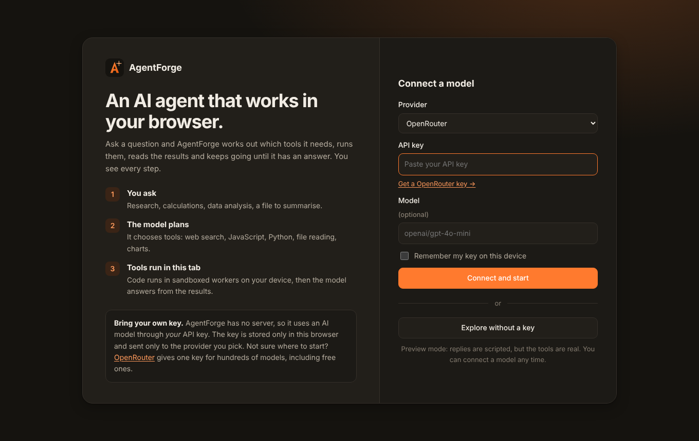
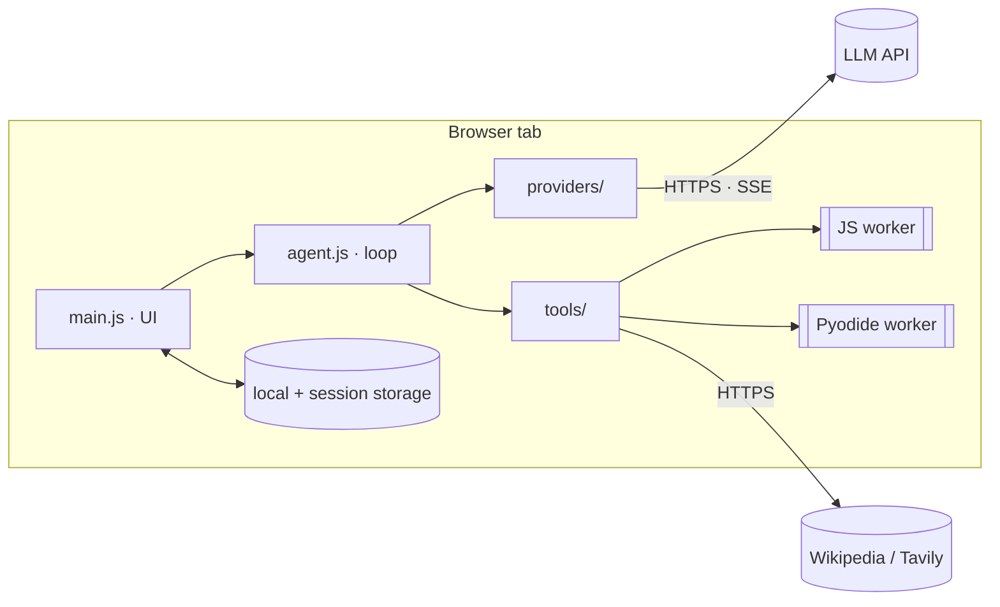

<p align="center">
  
</p>

<h1 align="center">AgentForge</h1>

<p align="center">
  An AI agent that thinks, uses tools and shows its work, running entirely in your browser.<br>
  <sub>No server · No build step · Works with any major LLM, or no key at all</sub>
</p>

<p align="center">
  <!-- Replace with your deployed URL -->
  <a href="https://agentforge.vercel.app"><b>Open the app</b></a> ·
  <a href="#quick-start">Quick start</a> ·
  <a href="#under-the-hood">Under the hood</a> ·
  <a href="#roadmap">Roadmap</a>
</p>

<p align="center">
  
  
  
  
</p>

<p align="center">
  
</p>

## Overview

Ask AgentForge a question and it doesn't just reply. It decides which tools it needs, calls them, reads what comes back and keeps going until it has an answer. You watch every step: each tool call appears as a card with its input, output and timing.

All of this happens in a single browser tab. Your API key goes directly to the model provider you choose, code runs in sandboxed workers on your machine, and conversations are saved in your browser. There is no backend to deploy or trust.

The first time you open it, a welcome screen explains how it works and asks you to choose:

- **Connect a model:** pick a provider and paste your API key. The key is checked on the spot and stored only in your browser.
- **Explore without a key:** **preview mode**, where a small scripted planner stands in for the model but the tools it calls are real. You can see the whole loop work in a few seconds.

<p align="center"></p>

A status badge in the top bar always shows where you stand: **Preview · no key**, **Connected** (with the provider and model), or **Key needed** when a provider is chosen but its key isn't available in the current tab.

## Features

**Tools the agent can use**

- 🔎 **Web search.** Wikipedia out of the box, or the whole web with a Tavily key. Answers cite their sources.
- 🟨 **JavaScript sandbox.** Runs in a Web Worker with a 10-second kill switch, so even `while (true) {}` can't hang the page.
- 🐍 **Python.** Real CPython via Pyodide (WebAssembly), with numpy and pandas on demand. Attached files are available at `/data/`.
- 📄 **File reading.** Drop in CSV, JSON, Markdown, code, text or PDF files and the agent can read and page through them.
- 📊 **Charts.** Bar, line, pie, doughnut, scatter and radar charts rendered inside the conversation.
- 🕒 **Date and time.** So "this week" means this week.

**Models**

OpenRouter · OpenAI · Anthropic · Google Gemini · Groq · AI Pipe · Ollama (local) · any OpenAI-compatible endpoint

**Experience**

- Responses stream in token by token.
- Optional **approval mode**: review and approve each piece of code before it runs.
- **Stop** a run at any moment, including mid-tool-call.
- Token usage per conversation, retry on errors, export to Markdown.
- Voice input, light and dark themes, a mobile layout, and installation as an app (PWA).

<p align="center">
  
</p>

## Quick start

**Use it:** open [the app](https://agentforge.vercel.app), then either connect a model on the welcome screen or explore in preview mode. You can connect later with the **Connect a model** button or from **Settings**. [OpenRouter](https://openrouter.ai/keys) is the easiest start: one key gives you hundreds of models. Pick one that supports tool calling, such as `openai/gpt-4o-mini`.

**Run it locally:**

```bash
git clone https://github.com/Riddhim-r/agentforge.git
cd agentforge
npm run dev    # http://localhost:5173
```

Any static file server works; there are no dependencies to install.

**Use a local model:** start Ollama with `OLLAMA_ORIGINS=*` so the browser can reach it, then choose **Ollama (local)** in Settings with a tool-capable model such as `qwen2.5` or `llama3.2`.

## Under the hood

### The agent loop

The core lives in [`src/core/agent.js`](src/core/agent.js) and knows nothing about the UI or any specific provider:

```text
history = [user message]
repeat up to maxSteps:
    reply = model(history, tool schemas)        # streamed
    if reply has no tool calls: done
    results = run all tool calls in parallel    # errors become results
    history += reply + results
```

Two details make it robust in practice:

- **Failures are information, not crashes.** An unknown tool, malformed JSON arguments, a timeout or a "Skip" from the user all go back to the model as an error result, so it can change course.
- **History repair.** If you stop a run between a tool call and its result, every provider API would reject the conversation from then on. `repairHistory()` fills the gap with a "cancelled" result, so the chat keeps working.

### One format, many providers

Internally every conversation uses one neutral message shape. Each provider is a thin adapter that converts it on the way out and parses the stream on the way back:

| Adapter | Providers | What it handles |
| --- | --- | --- |
| [`openai.js`](src/providers/openai.js) | OpenAI, OpenRouter, Gemini, Groq, AI Pipe, Ollama, custom | Rebuilds tool calls whose JSON arguments arrive in fragments across many SSE chunks |
| [`anthropic.js`](src/providers/anthropic.js) | Claude models | `tool_use` / `tool_result` blocks, `input_json_delta` streaming, merging parallel results into one turn |
| [`preview.js`](src/providers/preview.js) | No key (preview mode) | Keyword-based planner that calls the real tools |

Adding a provider means writing one file.

### Architecture



```text
src/
├── main.js            UI controller: conversations, live rendering, settings, files
├── render.js          sanitised Markdown, tool cards, charts
├── storage.js         persistence (keys in sessionStorage by default)
├── core/              agent loop · SSE parser · HTTP errors
├── providers/         openai · anthropic · preview · presets
└── tools/             web search · code runners + workers · files · charts
tests/                 unit tests on node:test, no dependencies
```

It's built with plain ES modules and no framework or bundler. Four small libraries load from a CDN (marked, DOMPurify, highlight.js, Chart.js). Pyodide and pdf.js download only the first time they're needed.

## Testing

```bash
npm test
```

The suite covers the agent loop (multi-step runs, parallel calls, step limits, errors, approvals, aborts and history repair), the SSE parser under arbitrary chunk splits, both provider adapters end to end with a mocked `fetch`, and every tool. GitHub Actions runs it on each push.

## Security and privacy

- **No server.** Nothing you type passes through a server of mine.
- **Keys** are sent only to the provider you selected. By default they live in `sessionStorage` and are forgotten when the tab closes.
- **Model output is sanitised** with DOMPurify before rendering, so injected HTML or scripts don't run.
- **Generated code** runs in a Web Worker, with no access to the page, your storage or your key. It has a hard timeout, and you can turn on approval for every run.
- As with any browser-based client, use keys with sensible spending limits.

## Known limitations

- Providers must accept browser (CORS) requests. The major ones do; some proxies don't.
- Keyless search covers Wikipedia only.
- Attached files stay in memory for the session and aren't saved with chats.
- The first Python run downloads about 10 MB (cached afterwards).

## Roadmap

- [ ] **MCP client:** connect to remote MCP servers and use their tools
- [ ] **On-device models** with WebLLM, so no key or network is needed
- [ ] **Trace export and replay** for debugging prompts and tool use
- [ ] Per-chat tool toggles and cost estimates
- [ ] Image input for vision models

## Author

Designed and built by **Riddhim Rathor**.

[Portfolio](https://riddhim-spotted-on.vercel.app) · [LinkedIn](https://www.linkedin.com/in/riddhim-rathor) · [GitHub](https://github.com/Riddhim-r)

Released under the [MIT License](LICENSE).
